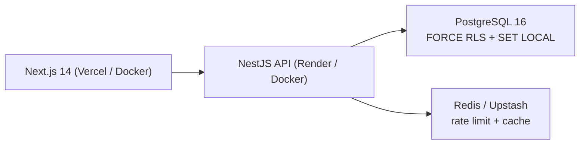

# Booking SaaS

Multi-tenant appointment booking: **NestJS** API and **Next.js** web app. PostgreSQL **Row Level Security** keeps tenants isolated. Availability uses the branch timezone (Luxon). Overlapping bookings are rejected by a database exclusion constraint.

## Demo

**Web:** https://booking-saas-web-two.vercel.app/login  
**API:** https://booking-saas-wrac.onrender.com/health

The first request after idle can take ~30–50 seconds (hosted API spins down). Retry once if login fails.

Password for all accounts: `ChangeMe123!`

| Role | Email | Login → Tenant |
|------|--------|----------------|
| Client (requests a booking) | `cliente@tenant.dev` | Tenant A or B |
| Tenant admin (accepts / rejects) | `admin@tenant.dev` | Tenant A — Demo Clínica / Tenant B — Demo Salón |
| Staff | `ana@tenant-a.dev` / `carlos@tenant-b.dev` | Tenant A / Tenant B |
| Platform admin | `admin@bookingsaas.dev` | Super admin |

Walkthrough: login as **cliente** → Tenant A → **Sucursal Centro** → New booking → weekday slot. Then logout and login as **admin** of the same tenant: pending rows are at the top → Aceptar or Rechazar. Tenant B has a different catalog and timezone (`America/Mexico_City`).

## Alerts center

`/alerts` (tenant admin and staff only) shows which bookings need a decision now: priority KPIs, status filters and a list sorted by urgency. Sign in as **admin** → **Alertas** → **Demo** for a self-contained dataset; **Datos reales** shows the tenant's own bookings.

The API has no severity field, so priority is derived client-side by pure, tested functions in [`apps/web/lib/alerts.ts`](apps/web/lib/alerts.ts):

| Priority | Rule |
|----------|------|
| Critical | `PENDING` expiring in < 3 min, or starting in < 60 min |
| High | Any other `PENDING` |
| Normal | `CONFIRMED` that has not ended |
| Closed | `CANCELLED`, `COMPLETED`, `NO_SHOW`, or `CONFIRMED` that has ended |

Design notes:

- Priority is conveyed by shape and label as well as color.
- Demo data is generated relative to the current time instead of seeded, because the API cancels `PENDING` bookings after 10 minutes.
- That 10-minute TTL is mirrored in the web app; a unit test reads the API source and fails if the two values diverge.

## Architecture



Request path for tenant data: JWT → `TenantGuard` → `TenantContextInterceptor` opens a transaction, `SET LOCAL app.current_tenant_id` (or `app.is_super_admin` for platform admins), then repositories query through `PrismaService.client` (AsyncLocalStorage). The runtime DB role is `booking_app` (subject to RLS); `booking_admin` is migrations-only.

## Stack

NestJS · Prisma · PostgreSQL 16 (RLS, `booking_admin` / `booking_app`) · Redis · Next.js 14 · Tailwind CSS · Vitest + Testing Library · GitHub Actions (lint, typecheck, unit, e2e, production images)

## AI / agents

If you're an AI coding agent (or a human using one) working in this repo, read [`AGENTS.md`](AGENTS.md) first — it has the hard rules (never bypass RLS, never invent an endpoint, keep diffs minimal, run e2e before calling a backend change done) and the architectural invariants this codebase depends on (the two-Postgres-role pattern, `@TenantScoped()`, the anti-double-booking exclusion constraint, timezone handling).

For a recurring task, start from a template in [`docs/prompts/`](docs/prompts/) instead of writing the request from scratch:
- [`add-endpoint.md`](docs/prompts/add-endpoint.md) — new API route.
- [`fix-tenant-bug.md`](docs/prompts/fix-tenant-bug.md) — suspected cross-tenant data leak.
- [`security-review.md`](docs/prompts/security-review.md) — checklist review of a diff or module.

**Separately:** the product itself has a small AI feature — `POST /ai/assist` (TENANT_ADMIN/STAFF only), a read-only assistant grounded strictly on the tenant's own PENDING bookings, with an explicit no-hallucination system prompt and a `503` (not a crash) when `OPENAI_API_KEY` isn't configured. Contract details in [`docs/ai-assist.md`](docs/ai-assist.md).

## Run locally

```bash
cp .env.example .env
docker compose up --build
```

Web: http://localhost:3000 · API: http://localhost:3001/health

Use the same demo emails and password as above. After a volume wipe (`docker compose down -v`), run migrations as `booking_admin` then seed before logging in with an old JWT.

## Tests

```bash
cd apps/api && npm test && npm run test:e2e   # unit + e2e (RLS, exclusion constraint, cache)
cd apps/web && npm test                       # Vitest + Testing Library
```

Each app has its own lockfile, so CI installs with `npm ci --no-workspaces`.

## Repository

```
apps/api    NestJS
apps/web    Next.js
docker/     Postgres init (btree_gist, app role)
docs/       Design notes (optional reading)
```

Production Dockerfiles: `apps/api/Dockerfile.prod`, `apps/web/Dockerfile.prod`.  
Intended AWS layout (not deployed): [docs/aws-target.md](docs/aws-target.md).  
Phase checklists and engineering notes: [docs/engineering-log.md](docs/engineering-log.md).  
Hosted demo runbook: [docs/deploy-demo.md](docs/deploy-demo.md).
