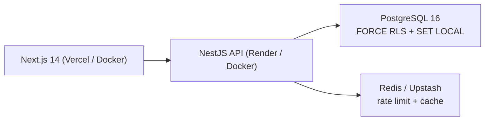

# Booking SaaS

[](https://github.com/whoyoshome/booking-saas/actions/workflows/ci.yml)
[](https://github.com/whoyoshome/booking-saas/actions/workflows/frontend.yml)

Multi-tenant appointment booking: **NestJS** API and **Next.js** web app. PostgreSQL **Row Level Security** keeps tenants isolated. Availability uses the branch timezone (Luxon). Overlapping bookings are rejected by a database exclusion constraint.

## Demo

**Web:** https://booking-saas-web-two.vercel.app/login  
**API:** https://booking-saas-wrac.onrender.com/health

The first request after idle can take ~30–50 seconds (hosted API spins down). Retry once if login fails.

Password for all accounts: `ChangeMe123!`

| Role | Email | Login → Business |
|------|--------|----------------|
| Client (requests a booking) | `cliente@tenant.dev` | Business A or B |
| Tenant admin (accepts / rejects) | `admin@tenant.dev` | Business A — Demo Clinic / Business B — Demo Salon |
| Staff | `ana@tenant-a.dev` / `carlos@tenant-b.dev` | Business A / Business B |
| Platform admin | `admin@bookingsaas.dev` | Super admin |

Walkthrough: login as **cliente** → Business A → **Downtown Branch** → New booking → weekday slot. Then sign out and sign in as **admin** of the same business: pending rows are at the top → Accept or Reject. Business B has a different catalog and timezone (`America/Mexico_City`).

## Alerts center

`/alerts` (tenant admin and staff only) shows which bookings need a decision now: priority KPIs, status filters and a list sorted by urgency. Sign in as **admin** → **Alerts** → **Demo** for a self-contained dataset; **Live data** shows the tenant's own bookings.

The API has no severity field, so priority is derived client-side by pure, tested functions in [`apps/web/lib/alerts.ts`](apps/web/lib/alerts.ts):

| Priority | Rule |
|----------|------|
| Critical | `PENDING` expiring in < 3 min, or starting in < 60 min |
| High | Any other `PENDING` |
| Normal | `CONFIRMED` that has not ended |
| Closed | `CANCELLED`, `COMPLETED`, `NO_SHOW`, or `CONFIRMED` that has ended |

Design notes:

- Priority is conveyed by shape and label as well as color.
- Demo data is generated relative to the current time instead of seeded, because the API cancels `PENDING` bookings after 10 minutes.
- That 10-minute TTL is mirrored in the web app; a unit test reads the API source and fails if the two values diverge.

## Architecture



Request path for tenant data: JWT → `TenantGuard` → `TenantContextInterceptor` opens a transaction, `SET LOCAL app.current_tenant_id` (or `app.is_super_admin` for platform admins), then repositories query through `PrismaService.client` (AsyncLocalStorage). The runtime DB role is `booking_app` (subject to RLS); `booking_admin` is migrations-only.

## Stack

NestJS · Prisma · PostgreSQL 16 (RLS, `booking_admin` / `booking_app`) · Redis · Next.js 14 · Tailwind CSS · Vitest + Testing Library · Playwright + axe-core · GitHub Actions (lint, typecheck, unit, API e2e, browser e2e, production images)

## AI / agents

If you're an AI coding agent (or a human using one) working in this repo, read [`AGENTS.md`](AGENTS.md) first — it has the hard rules (never bypass RLS, never invent an endpoint, keep diffs minimal, run e2e before calling a backend change done) and the architectural invariants this codebase depends on (the two-Postgres-role pattern, `@TenantScoped()`, the anti-double-booking exclusion constraint, timezone handling).

For a recurring task, start from a template in [`docs/prompts/`](docs/prompts/) instead of writing the request from scratch:
- [`add-endpoint.md`](docs/prompts/add-endpoint.md) — new API route.
- [`fix-tenant-bug.md`](docs/prompts/fix-tenant-bug.md) — suspected cross-tenant data leak.
- [`security-review.md`](docs/prompts/security-review.md) — checklist review of a diff or module.

**Separately:** the product itself has a small AI feature — `POST /ai/assist` (TENANT_ADMIN/STAFF only), a read-only assistant grounded strictly on the tenant's own PENDING bookings, with an explicit no-hallucination system prompt and a `503` (not a crash) when `OPENAI_API_KEY` isn't configured. Contract details in [`docs/ai-assist.md`](docs/ai-assist.md).

## Run locally

```bash
cp .env.example .env
docker compose up --build
```

Web: http://localhost:3000 · API: http://localhost:3001/health

On a new database (first run, or after `docker compose down -v`), apply the migrations as `booking_admin` (the owner role; the runtime `booking_app` role can't create tables), then load the base seed and the demo data (branches, services, staff, schedules):

```bash
docker compose exec api sh -c 'DATABASE_URL="$DATABASE_MIGRATE_URL" npx prisma migrate deploy'
```

```bash
docker compose exec api npm run seed
```

```bash
docker compose exec api npm run seed:demo
```

Then log in with the demo emails and password above (log in again if the browser still holds a JWT from the previous database).

## Testing

| Layer | Tool | What it proves | Where | CI |
|---|---|---|---|---|
| API unit + e2e | Jest + Supertest | RLS tenant isolation, the double-booking exclusion constraint, cache invalidation, auth (64 e2e tests on real Postgres/Redis) | `apps/api/test/`, `apps/api/src/**/*.spec.ts` | `ci.yml` → `lint-and-unit`, `e2e` |
| Web unit / components | Vitest + Testing Library | Alert rules and formatting; login errors and redirect, the bookings list (PENDING first, role-gated actions, confirm), loading/503 states. Queries by role and label, only `fetch` and the router are faked | `apps/web/**/*.test.ts(x)` | `ci.yml` → `web` (with lint and `tsc`) |
| Browser E2E | Playwright | Real login; a full booking; a **real 409**: the slot is taken through the API while the client is on the confirm screen, the UI shows the conflict and the slot disappears | `apps/web/e2e/login.spec.ts`, `booking.spec.ts` | `frontend.yml` |
| Accessibility | `@axe-core/playwright` + keyboard tests | No WCAG 2.0/2.1 A/AA violations on login, both dashboards, `/alerts` and every booking step (no rules disabled); keyboard-only login and booking, visible focus, focus moving to each new step, errors announced | `apps/web/e2e/a11y.spec.ts` | `frontend.yml` |
| Lazy loading | Playwright | A CLIENT never downloads the admin-only assistant chunk; admins get it as a separate chunk; its placeholder has the same height (no layout shift) | `apps/web/e2e/lazy-loading.spec.ts` | `frontend.yml` |

Browser tests run against the production web build and the real API, database and Redis. Nothing is mocked except one keyboard test, which stubs the login response so it doesn't count against the 5/min login throttle.

### Unit tests (no services needed)

```bash
cd apps/web && npm ci --no-workspaces && npm test
```

```bash
cd apps/api && npm ci --no-workspaces && npm test
```

### API e2e with Docker

With the stack up and the database migrated and seeded (see [Run locally](#run-locally)):

```bash
docker compose exec api npm run test:e2e
```

### Browser tests (Playwright) with Docker

Docker runs Postgres, Redis and the API. Playwright runs on the host (Node 20+) against a production build of the web app, which it starts itself, like CI.

1. Start the backend services, then migrate and seed (`seed:demo` is required; the base seed has no branches or staff):

```bash
docker compose up -d --build postgres redis api
```

```bash
docker compose exec api sh -c 'DATABASE_URL="$DATABASE_MIGRATE_URL" npx prisma migrate deploy'
```

```bash
docker compose exec api npm run seed
```

```bash
docker compose exec api npm run seed:demo
```

2. Stop the dev web container if it's running, so port 3000 is free for the production build:

```bash
docker compose stop web
```

3. Install, build and run (the API on :3001 is reused):

```bash
cd apps/web && npm ci --no-workspaces && npx playwright install chromium && npm run build && npm run test:e2e
```

Notes:
- Tests create bookings in the database. They pick free slots, so re-runs work; `docker compose down -v` resets everything.
- `POST /auth/login` allows 5 requests per minute per IP. Sessions are saved in `apps/web/e2e/.auth/` (git-ignored) and reused while valid, so back-to-back runs are fine.
- On failure, open the report with `npx playwright show-report` (in CI it's uploaded as an artifact).
- `.github/workflows/frontend.yml` lists the same steps without Docker.

Each app has its own lockfile, so CI installs with `npm ci --no-workspaces`.

## Repository

```
apps/api    NestJS
apps/web    Next.js
docker/     Postgres init (btree_gist, app role)
docs/       Design notes (optional reading)
```

Production Dockerfiles: `apps/api/Dockerfile.prod`, `apps/web/Dockerfile.prod`.  
Intended AWS layout (not deployed): [docs/aws-target.md](docs/aws-target.md).  
Design decisions and known limitations: [docs/design-decisions.md](docs/design-decisions.md).  
Hosted demo runbook: [docs/deploy-demo.md](docs/deploy-demo.md).
